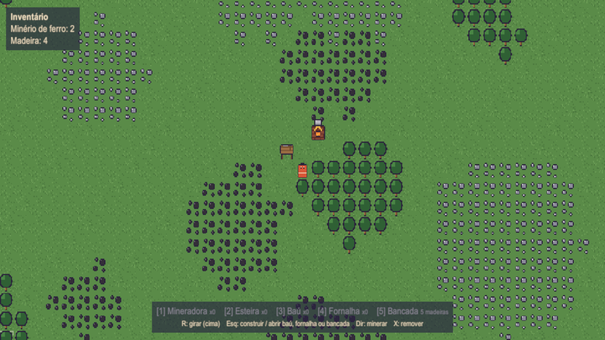
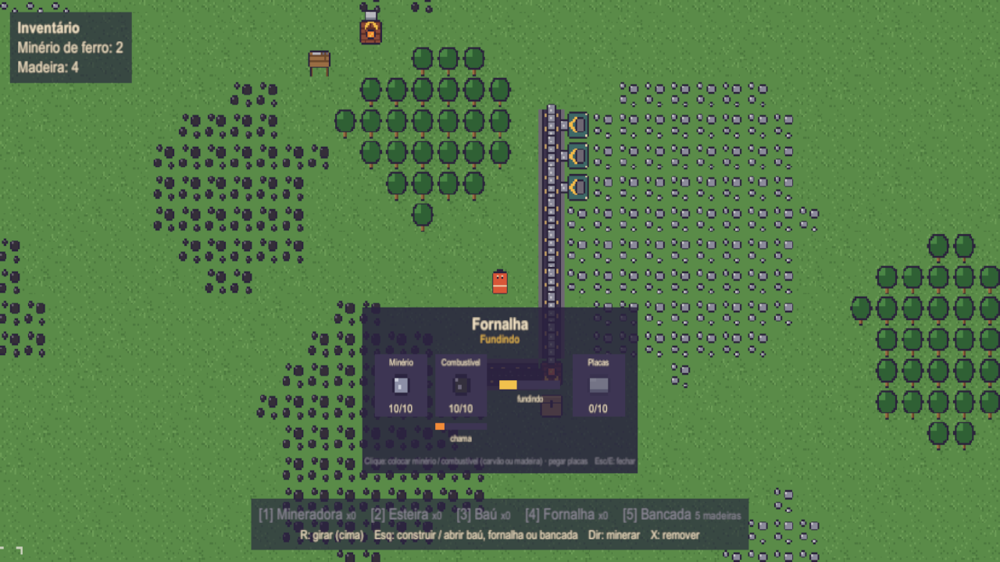
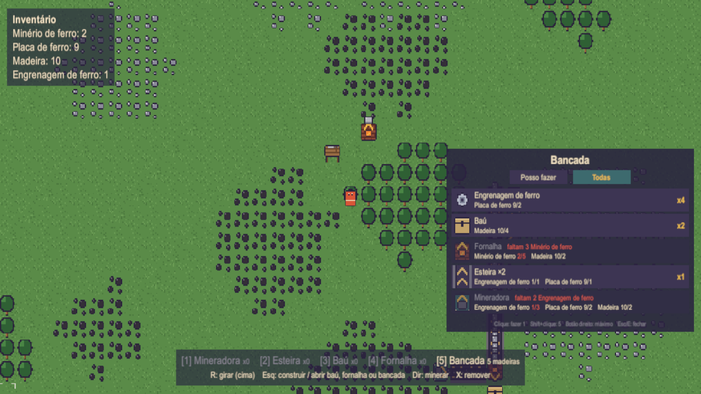

# Nicotório

Protótipo de jogo de automação em visão de cima, feito em **Unity 6** (URP 2D). Você começa cortando árvores e monta uma bancada de criação. Depois minera ferro e carvão, funde o minério em placas numa fornalha e cria na bancada as mineradoras, esteiras e baús que automatizam tudo.

## O que tem

- **Mapa 64x64** com bosques, manchas de minério de ferro e de carvão, gerados a partir de uma seed (o mapa é sempre o mesmo).
- **Coleta manual**: segure o botão direito sobre um minério, carvão ou árvore próximos.
  - Cada árvore dá 4 madeiras e depois some.
  - Não dá para construir em cima de árvore, mas dá para andar por cima.
- **Bancada**: custa 5 madeiras e é a primeira construção.
  - Clique nela para abrir a lista de receitas.
  - O filtro **"Posso fazer"** mostra o que dá para fazer agora, e **"Todas"** mostra tudo, com o que falta em vermelho.
  - Clique numa receita para fazer 1, Shift+clique para fazer 5, botão direito para fazer o máximo.
- **Mineradora**: só pode ser colocada em minério. Produz 1 minério por segundo e entrega no tile para onde a seta aponta. Se não tiver onde entregar, ela segura o item e para.
- **Esteira**: leva os itens na direção da seta e entrega na próxima esteira ou num baú. Quando uma esteira enche, ela trava a de trás.
- **Baú**: guarda tudo o que chega. Clique nele para pegar o conteúdo.
- **Fornalha**: transforma 1 minério de ferro em 1 placa de ferro a cada 2 segundos e entrega a placa no tile para onde a seta aponta.
  - Queima **carvão** (1 carvão = 4 placas) ou **madeira** (1 madeira = 2 placas). O combustível só é gasto enquanto a fornalha funde.
  - Guarda até 10 minérios, 10 combustíveis e 10 placas.
  - Pode ser alimentada por mineradoras e esteiras. Traga o minério e o carvão por **esteiras separadas** (por lados diferentes da fornalha): numa esteira misturada, quando o slot de carvão enche, um carvão parado na frente trava o minério que vem atrás.
  - **Clique nela para abrir a janela**: clique no slot de minério ou de combustível para colocar o seu, e no de placas para pegar as prontas.
- **As construções são itens criados na bancada.** Colocar gasta 1 item e remover devolve o item:

  | Receita | Ingredientes |
  |---|---|
  | Engrenagem de ferro | 2 placas de ferro |
  | Baú | 4 madeiras |
  | Fornalha | 5 minérios de ferro + 2 madeiras |
  | Esteira (sai 2) | 1 engrenagem + 1 placa de ferro |
  | Mineradora | 3 engrenagens + 2 placas de ferro + 2 madeiras |

  Você começa sem nada:
  1. Corte árvores e construa a **bancada** (5 madeiras).
  2. Minere 5 minérios e crie uma **fornalha**.
  3. Abasteça a fornalha com minério e use **madeira como combustível**. Ainda não precisa de carvão.
  4. Pegue as placas, faça **engrenagens** e depois a primeira **mineradora**.

  A hotbar mostra quantos itens de cada construção você tem ("x3"; a bancada mostra o custo em madeira) e fica cinza quando você não tem nenhum.

| Começo: bancada e fornalha queimando madeira | Janela da fornalha |
|---|---|
|  |  |

| Bancada de criação |
|---|
|  |

## Controles

| Tecla | Ação |
|---|---|
| **WASD** | andar |
| **Botão direito** (segurar) | minerar ferro ou carvão, ou cortar árvore, sob o mouse (alcance de 3 tiles) |
| **1 / 2 / 3 / 4 / 5** | escolher mineradora / esteira / baú / fornalha / bancada (aperte de novo para desmarcar) |
| **R** | girar a construção |
| **Botão esquerdo** | construir; segure e arraste para fazer uma linha |
| **Botão esquerdo no baú** | pegar tudo o que está nele |
| **Botão esquerdo na fornalha** | abrir a janela da fornalha (clique nos slots para colocar minério/carvão e pegar placas) |
| **Botão esquerdo na bancada** | abrir a lista de receitas (clique: 1, Shift+clique: 5, botão direito: o máximo) |
| **Esc / E** | fechar a janela da fornalha ou da bancada |
| **X** | remover a construção sob o mouse; o que ela tinha volta para você |

## Como rodar

1. Abra a pasta no **Unity 6000.6.8f1**.
2. Abra a cena `Assets/Scenes/Factory` e dê **Play**.

A cena está vazia de propósito: a câmera, o mapa, o jogador e a interface são criados por código quando o jogo começa.

## Gráficos

Os gráficos ficam em **`Assets/Resources/Sprites/`**, um PNG de 16x16 para cada um:

| Arquivo | O que é |
|---|---|
| `grass_1.png`, `grass_2.png` | duas variações de grama |
| `iron_ore.png`, `coal_ore.png`, `tree.png` | tiles de minério de ferro, de carvão e de árvore |
| `player.png` | jogador |
| `miner.png`, `belt.png`, `chest.png`, `furnace.png`, `crafting_table.png` | mineradora, esteira, baú, fornalha e bancada, **desenhados apontando para cima** |
| `item_iron_ore.png`, `item_iron_plate.png`, `item_coal.png`, `item_wood.png`, `item_iron_gear.png` | minério, placa, carvão, madeira e engrenagem |
| `cursor_frame.png` | moldura do cursor, em branco (o jogo pinta a cor) |

**Para mudar um gráfico, sobrescreva o PNG com o mesmo nome.** O Unity aplica sozinho as configurações de pixel art: 16 pixels por tile, filtro Point, sem compressão e sem mipmaps. Não precisa mexer no Inspector. Todos os sprites são juntados num **Sprite Atlas** (`Assets/Resources/SpriteAtlas.spriteatlasv2`), uma textura só, para o jogo desenhar tudo com poucas chamadas.

No menu **Factory > Sprites** do Unity:
- **Exportar sprites gerados**: recria os PNGs que estiverem faltando;
- **Restaurar todos os sprites originais**: volta aos desenhos originais.

Se algum PNG sumir, o jogo continua funcionando e desenha aquele sprite por código.

## Como foi feito

- **Simulação separada da apresentação.**
  - A simulação (`Assets/Scripts/Simulation`) é C# puro, sem `UnityEngine`. Ela roda num tick fixo de 20 por segundo e é determinística.
  - A apresentação (`Assets/Scripts/Presentation`) só desenha o estado da simulação e transforma o input em comandos.
- **Os itens nas esteiras são dados**, não GameObjects: cada item tem uma posição inteira ao longo da esteira, e a apresentação só desenha esses itens.
- **Há um único ponto de entrada**, o `GameBootstrap`, que cria a simulação e entrega para quem precisa. Não há singletons espalhados.

Detalhes da arquitetura e das convenções estão em [`CLAUDE.md`](CLAUDE.md).

## Testes

Os testes EditMode (`Assets/Tests/EditMode`) cobrem:
- geração do mapa;
- mineração manual;
- regras de construção;
- ritmo da mineradora e da fornalha;
- carvão: queima, manchas no mapa e linhas separadas de minério e carvão;
- madeira: árvores no mapa, corte, árvore que vira grama e madeira como combustível;
- criação: receitas, alcance da bancada e consultas do que dá para fazer;
- movimento e bloqueio das esteiras;
- acúmulo no baú;
- construções como itens, incluindo o caminho completo do inventário vazio até a primeira mineradora usando só madeira como combustível.

Para rodar, abra no Unity **Window > General > Test Runner > EditMode > Run All**. Saia do Play mode antes.
