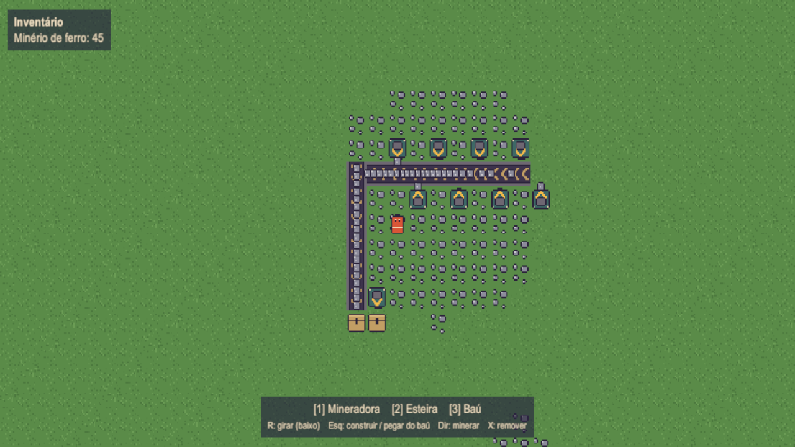
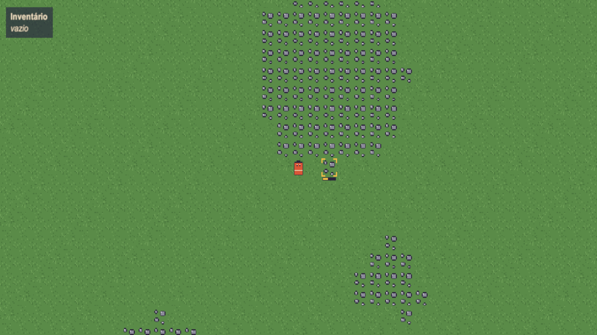
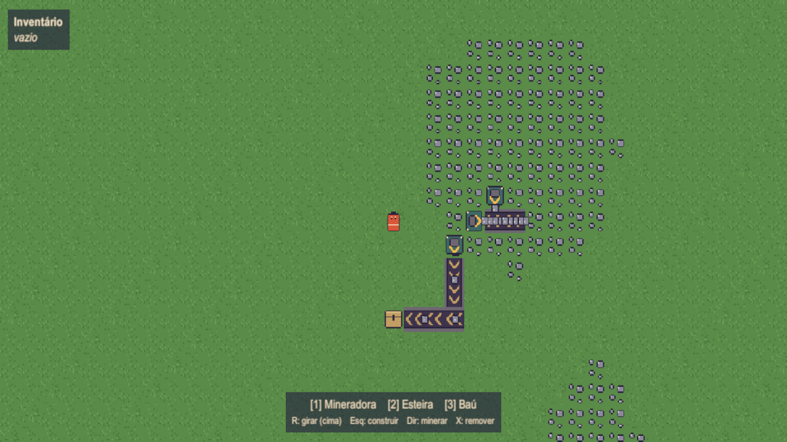
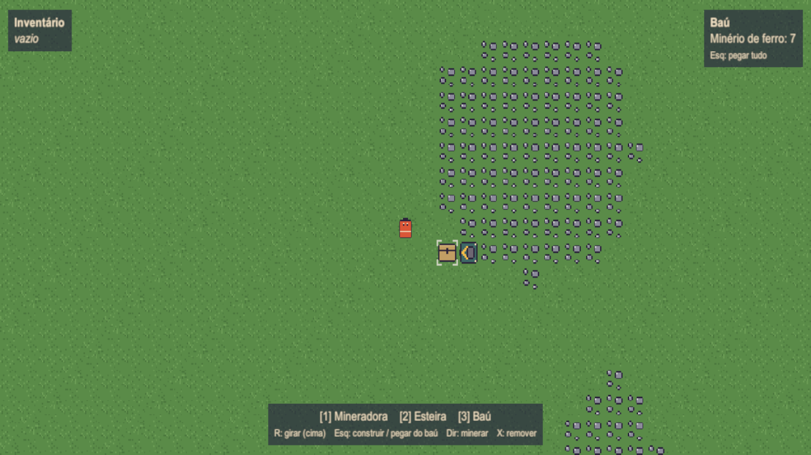

# Nicotório

Protótipo de jogo de automação em visão de cima, feito em **Unity 6** (URP 2D). Você minera ferro na mão, monta mineradoras, liga tudo com esteiras e junta a produção em baús.

## O que tem

- **Mapa 64x64** com manchas de minério de ferro, geradas a partir de uma seed (o mapa é sempre o mesmo).
- **Mineração manual**: segure o botão direito sobre um minério próximo para ir enchendo o inventário.
- **Mineradora**: só pode ser colocada em minério. Produz 1 minério por segundo e entrega no tile para onde a seta aponta. Se não tiver onde entregar, ela segura o item e para.
- **Esteira**: leva os itens na direção da seta e entrega na próxima esteira ou num baú. Quando uma esteira enche, ela trava a de trás.
- **Baú**: guarda tudo o que chega. Clique nele para pegar o conteúdo.

| Mineração manual | Esteira cheia trava a de trás |
|---|---|
|  |  |

| Conteúdo do baú ao passar o mouse |
|---|
|  |

## Controles

| Tecla | Ação |
|---|---|
| **WASD** | andar |
| **Botão direito** (segurar) | minerar o minério sob o mouse (alcance de 3 tiles) |
| **1 / 2 / 3** | escolher mineradora / esteira / baú (aperte de novo para desmarcar) |
| **R** | girar a construção |
| **Botão esquerdo** | construir; segure e arraste para fazer uma linha |
| **Botão esquerdo no baú** | pegar tudo o que está nele |
| **X** | remover a construção sob o mouse; o que ela tinha volta para você |

## Como rodar

1. Abra a pasta no **Unity 6000.6.8f1**.
2. Abra a cena `Assets/Scenes/Factory` e dê **Play**.

A cena está vazia de propósito: a câmera, o mapa, o jogador e a interface são criados por código quando o jogo começa.

## Gráficos

Os gráficos ficam em **`Assets/Resources/Sprites/`**, um PNG de 16x16 para cada um:

| Arquivo | O que é |
|---|---|
| `grass_1.png`, `grass_2.png` | duas variações de grama |
| `iron_ore.png` | tile de minério de ferro |
| `player.png` | jogador |
| `miner.png`, `belt.png`, `chest.png` | mineradora, esteira e baú, **desenhados apontando para cima** |
| `item_iron_ore.png` | minério andando na esteira |
| `cursor_frame.png` | moldura do cursor, em branco (o jogo pinta a cor) |

**Para mudar um gráfico, sobrescreva o PNG com o mesmo nome.** O Unity aplica sozinho as configurações de pixel art: 16 pixels por tile, filtro Point, sem compressão e sem mipmaps. Não precisa mexer no Inspector. Todos os sprites são juntados num **Sprite Atlas** (`Assets/Resources/SpriteAtlas.spriteatlasv2`), uma textura só, para o jogo desenhar tudo com poucas chamadas.

No menu **Factory > Sprites** do Unity:
- **Exportar sprites gerados**: recria os PNGs que estiverem faltando;
- **Restaurar todos os sprites originais**: volta aos desenhos originais.

Se algum PNG sumir, o jogo continua funcionando e desenha aquele sprite por código.

## Como foi feito

- **Simulação separada da apresentação.**
  - A simulação (`Assets/Scripts/Simulation`) é C# puro, sem `UnityEngine`. Ela roda num tick fixo de 20 por segundo e é determinística.
  - A apresentação (`Assets/Scripts/Presentation`) só desenha o estado da simulação e transforma o input em comandos.
- **Os itens nas esteiras são dados**, não GameObjects: cada item tem uma posição inteira ao longo da esteira, e a apresentação só desenha esses itens.
- **Há um único ponto de entrada**, o `GameBootstrap`, que cria a simulação e entrega para quem precisa. Não há singletons espalhados.

Detalhes da arquitetura e das convenções estão em [`CLAUDE.md`](CLAUDE.md).

## Testes

Os testes EditMode (`Assets/Tests/EditMode`) cobrem:
- geração do mapa;
- mineração manual;
- regras de construção;
- ritmo da mineradora;
- movimento e bloqueio das esteiras;
- acúmulo no baú.

Para rodar, abra no Unity **Window > General > Test Runner > EditMode > Run All**. Saia do Play mode antes.
